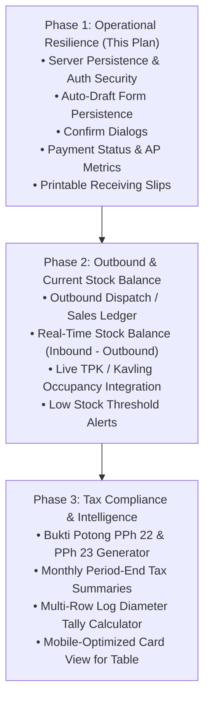

# Business Foundation & Financial Operations Implementation Plan

> **For agentic workers:** REQUIRED SUB-SKILL: Use superpowers:subagent-driven-development (recommended) or superpowers:executing-plans to implement this plan task-by-task. Steps use checkbox (`- [ ]`) syntax for tracking.

**Goal:** Transform TimberGuard from an isolated single-browser receiving log into a production-resilient operational platform by implementing authenticated server-backed data persistence, auto-draft form recovery, destructive action safeguards, end-to-end payment status tracking, and printable timber yard receiving slips.

**Architecture:**
- Thread-safe server-side persistence in `src/persistence/server-record-store.ts` serving Next.js API routes (`/api/records`) with role-based write authorization.
- Resilient client synchronization in `src/hooks/useWoodRecords.ts`: immediate optimistic UI updates backed by `localStorage` with asynchronous server-side synchronization.
- Operational safeguards: debounced auto-draft caching in `RecordModal.tsx` to prevent data loss on browser interruptions, and an accessible `ConfirmDialog.tsx` modal for destructive deletions.
- Accounts Payable & Cash Flow SSOT: extended `WoodReceivingRecord` schema (`paymentStatus`, `invoiceNumber`, `paymentDate`, `paymentNotes`), live AP outstanding metrics in `KpiCards.tsx`, and bilingual payment status badges in `RecordTable.tsx`.
- Standard mill receiving receipt: dedicated print-ready component `PrintReceivingSlipModal.tsx` conforming to Indonesian timber gate inspection standards.

**Tech Stack:** Node.js 26.8.1 (Native ESM & TypeScript), Next.js 15.1, React 19, Tailwind CSS 3.4, Lucide React, `node:test` + `node:assert`.

**Spec:** [business-improvement-audit.md](file:///Users/mac/.gemini/antigravity/brain/3b52f56c-14dd-4518-8d35-def35993ee5d/business-improvement-audit.md)

## Global Constraints
- Maximum file size: keep all modules under ~250 LOC (Strangler pattern on God files).
- Single Source of Truth (SSOT): all domain interfaces and entities must be imported from `src/types/index.ts`.
- Zero external dependencies: rely strictly on native Node.js (`crypto`, `fs/promises`), React 19, and existing Tailwind primitives.
- Automated test coverage: every task must provide automated tests executed via `node --test` with 0 failures.
- Language standard: source code, types, and git commits in English; user-facing labels bilingual Indonesian-Chinese.

---

### Task 1: API Route Protection & Session Security Hardening

**Files:**
- Modify: `middleware.ts:5-33`
- Modify: `src/auth/session.ts:1-35`
- Test: `test/middleware-api-auth.test.ts`

**Interfaces:**
- Consumes: `verifySessionToken`, `COOKIE_NAME` from `src/auth/session.ts`
- Produces: JSON 401 `{ success: false, error: 'Unauthorized' }` for unauthenticated requests to `/api/*` (except public `/api/auth/login`).

- [x] **Step 1: Write the failing test**
- [x] **Step 2: Run test to verify it fails**
- [x] **Step 3: Write minimal implementation**
- [x] **Step 4: Run test to verify it passes**
- [x] **Step 5: Commit**

```bash
git add middleware.ts test/middleware-api-auth.test.ts
git commit -m "security: protect api routes with session authentication in middleware"
```

---

### Task 2: Shared Server-Side Persistence for Records API

**Files:**
- Create: `src/persistence/server-record-store.ts`
- Modify: `app/api/records/route.ts`
- Test: `test/server-record-store.test.ts`

**Interfaces:**
- Consumes: `WoodReceivingRecord` from `src/types/index.ts`, `SEED_WOOD_RECORDS` from `src/persistence/seed-data.ts`
- Produces: `ServerRecordStore` class (`getAll()`, `save()`, `delete()`, `reset()`) and REST endpoints `GET`, `POST`, `DELETE` at `/api/records`.

- [x] **Step 1: Write the failing test**
- [x] **Step 2: Run test to verify it fails**
- [x] **Step 3: Write minimal implementation**
- [x] **Step 4: Run test to verify it passes**
- [x] **Step 5: Commit**

```bash
git add src/persistence/server-record-store.ts app/api/records/route.ts test/server-record-store.test.ts
git commit -m "feat: implement server-side json store and authenticated records api"
```

---

### Task 3: Client-Side Resilient Sync in useWoodRecords

**Files:**
- Modify: `src/hooks/useWoodRecords.ts`
- Test: `test/use-wood-records.test.ts`

**Interfaces:**
- Consumes: `/api/records` endpoint, `localStorage`
- Produces: `useWoodRecords` returning `{ records, allRecords, metrics, filters, setFilters, saveRecord, deleteRecord, restoreRecord, resetDemo, isSyncing }`.

- [x] **Step 1: Write the failing test**
- [x] **Step 2: Run test to verify it fails**
- [x] **Step 3: Write minimal implementation**
- [x] **Step 4: Run test to verify it passes**
- [x] **Step 5: Commit**

```bash
git add src/hooks/useWoodRecords.ts src/utils/records-csv.ts test/use-wood-records.test.ts
git commit -m "feat: add optimistic server synchronization with offline fallback to useWoodRecords"
```

---

### Task 4: Auto-Draft Persistence for RecordModal

**Files:**
- Modify: `src/components/ledger/RecordModal.tsx`
- Test: `test/record-modal-draft.test.ts`

**Interfaces:**
- Consumes: `localStorage` key `wood_record_form_draft_v1`
- Produces: Auto-save on form change, recovery banner when opening in Add mode, draft cleanup on submit or discard.

- [x] **Step 1: Write the failing test**
- [x] **Step 2: Run test to verify it fails**
- [x] **Step 3: Write minimal implementation**
- [x] **Step 4: Run test to verify it passes**
- [x] **Step 5: Commit**

```bash
git add src/components/ledger/RecordModal.tsx src/components/ledger/DraftRecoveryBanner.tsx src/components/ledger/RecordModalSections.tsx src/utils/record-draft.ts test/record-modal-draft.test.ts
git commit -m "feat: add auto-draft persistence and recovery banner to RecordModal"
```

---

### Task 5: Destructive Action Safeguard (ConfirmDialog)

**Files:**
- Create: `src/components/ui/ConfirmDialog.tsx`
- Modify: `app/ledger/page.tsx:55-70`
- Modify: `app/suppliers/page.tsx:98-111`
- Test: `test/confirm-dialog.test.ts`

**Interfaces:**
- Produces: `<ConfirmDialog isOpen={...} title={...} description={...} confirmLabel={...} onConfirm={...} onCancel={...} />`

- [x] **Step 1: Write the failing test**
- [x] **Step 2: Run test to verify it fails**
- [x] **Step 3: Write minimal implementation**
- [x] **Step 4: Run test to verify it passes**
- [x] **Step 5: Commit**

```bash
git add src/components/ui/ConfirmDialog.tsx src/components/suppliers/SupplierStatsGrid.tsx app/ledger/page.tsx app/suppliers/page.tsx test/confirm-dialog.test.ts
git commit -m "feat: add ConfirmDialog modal and wire into record and supplier delete actions"
```

---

### Task 6: Payment Status & Accounts Payable Tracking

**Files:**
- Modify: `src/types/index.ts:130-205`
- Modify: `src/utils/timber-calc.ts:120-190`
- Modify: `src/components/ledger/RecordModal.tsx`
- Modify: `src/components/ledger/RecordTable.tsx`
- Modify: `src/components/ledger/Toolbar.tsx`
- Modify: `src/components/dashboard/KpiCards.tsx`
- Test: `test/payment-tracking.test.ts`

**Interfaces:**
- Consumes: `WoodReceivingRecord`
- Produces: `PaymentStatus` ('UNPAID' | 'PARTIAL' | 'PAID'), `totalOutstandingPayable`, `unpaidRecordsCount`, and payment status UI badges/filters.

- [x] **Step 1: Write the failing test**

```typescript
// test/payment-tracking.test.ts
import { test } from 'node:test';
import assert from 'node:assert';
import { aggregateDashboardMetrics } from '../src/utils/timber-calc.ts';
import type { WoodReceivingRecord } from '../src/types/index.ts';

test('Payment Status & Accounts Payable Aggregation Suite', async (t) => {
  const records: WoodReceivingRecord[] = [
    {
      id: 'r1',
      receiptDate: '2026-10-14',
      truckPlateNumber: 'B 1111 AAA',
      forestryDocNumber: 'DOC-1',
      receiptNumber: 'KW-1',
      contractNumber: 'CTR-1',
      supplierName: 'Supplier A',
      woodSpecies: 'Jati',
      woodLengthM: 4,
      kavlingNumber: 'KAV-01',
      storageYard: 'TPK-1',
      deliveredPieces: 10,
      deliveredVolumeM3: 5,
      tallyPieces: 10,
      tallyVolumeM3: 5,
      timberPricePerM3: 1000,
      timberGrossTotal: 5000,
      timberPphRate: 0,
      timberPphAmount: 0,
      timberNetPayable: 5000,
      freightRatePerM3: 100,
      freightGrossTotal: 500,
      freightPphAmount: 0,
      freightNetPayable: 500,
      brokerFee: 0,
      grandNetPayable: 5500,
      paymentStatus: 'UNPAID',
      createdAt: '2026-10-14T00:00:00.000Z',
      updatedAt: '2026-10-14T00:00:00.000Z',
    },
    {
      id: 'r2',
      receiptDate: '2026-10-15',
      truckPlateNumber: 'B 2222 BBB',
      forestryDocNumber: 'DOC-2',
      receiptNumber: 'KW-2',
      contractNumber: 'CTR-2',
      supplierName: 'Supplier B',
      woodSpecies: 'Merbau',
      woodLengthM: 4,
      kavlingNumber: 'KAV-02',
      storageYard: 'TPK-1',
      deliveredPieces: 20,
      deliveredVolumeM3: 10,
      tallyPieces: 20,
      tallyVolumeM3: 10,
      timberPricePerM3: 1000,
      timberGrossTotal: 10000,
      timberPphRate: 0,
      timberPphAmount: 0,
      timberNetPayable: 10000,
      freightRatePerM3: 100,
      freightGrossTotal: 1000,
      freightPphAmount: 0,
      freightNetPayable: 1000,
      brokerFee: 0,
      grandNetPayable: 11000,
      paymentStatus: 'PAID',
      createdAt: '2026-10-15T00:00:00.000Z',
      updatedAt: '2026-10-15T00:00:00.000Z',
    },
  ];

  await t.test('aggregates total outstanding payable for UNPAID and PARTIAL records', () => {
    const metrics = aggregateDashboardMetrics(records);
    assert.strictEqual(metrics.totalOutstandingPayable, 5500);
    assert.strictEqual(metrics.unpaidRecordsCount, 1);
  });
});
```

- [x] **Step 2: Run test to verify it fails**

Run: `node --test test/payment-tracking.test.ts`
Expected: FAIL (`metrics.totalOutstandingPayable` is undefined).

- [x] **Step 3: Write minimal implementation**

1. In `src/types/index.ts`:
```typescript
export type PaymentStatus = 'UNPAID' | 'PARTIAL' | 'PAID';

// in WoodReceivingRecord:
paymentStatus?: PaymentStatus;
invoiceNumber?: string;
paymentDate?: string;
paymentNotes?: string;

// in RecordFilterCriteria:
paymentStatus?: PaymentStatus | 'ALL';

// in DashboardMetrics:
totalOutstandingPayable: number;
unpaidRecordsCount: number;
```

2. In `src/utils/timber-calc.ts`:
Calculate `totalOutstandingPayable` by summing `grandNetPayable` where `paymentStatus !== 'PAID'`, and count `unpaidRecordsCount`. Default `paymentStatus` to `'UNPAID'` if omitted.

3. In `src/components/ledger/RecordModal.tsx`:
Add Payment Status section:
- `paymentStatus`: Select ('UNPAID' / 'PARTIAL' / 'PAID')
- `invoiceNumber`: Input text
- `paymentDate`: Input date

4. In `src/components/ledger/RecordTable.tsx`:
Add "Status Bayar" column:
- UNPAID: `<span className="px-2 py-0.5 rounded-full text-[11px] font-bold bg-rose-50 text-rose-600 border border-rose-200">Belum Bayar (未付)</span>`
- PARTIAL: `<span className="px-2 py-0.5 rounded-full text-[11px] font-bold bg-amber-50 text-amber-700 border border-amber-200">Sebagian (部分)</span>`
- PAID: `<span className="px-2 py-0.5 rounded-full text-[11px] font-bold bg-emerald-50 text-emerald-600 border border-emerald-200">Lunas (已结清)</span>`

5. In `src/components/ledger/Toolbar.tsx`:
Add Payment Status filter pill group (`Semua`, `Belum Lunas`, `Lunas`).

6. In `src/components/dashboard/KpiCards.tsx`:
Add an Accounts Payable Hero Card displaying `totalOutstandingPayable` and count of pending disbursements.

- [x] **Step 4: Run test to verify it passes**

Run: `node --test test/payment-tracking.test.ts`
Expected: PASS with 1 passing test.

- [x] **Step 5: Commit**

```bash
git add src/types/index.ts src/utils/timber-calc.ts src/components/ledger/RecordModal.tsx src/components/ledger/RecordTable.tsx src/components/ledger/Toolbar.tsx src/components/dashboard/KpiCards.tsx test/payment-tracking.test.ts
git commit -m "feat: add payment status tracking, ap outstanding metrics, and status filter"
```

---

### Task 7: Printable Receiving Slip (Tanda Terima Kayu Masuk)

**Files:**
- Create: `src/components/ledger/PrintReceivingSlipModal.tsx`
- Modify: `src/components/ledger/RecordTable.tsx`
- Test: `test/print-receiving-slip.test.ts`

**Interfaces:**
- Consumes: `WoodReceivingRecord`
- Produces: Printable bilingual timber receiving slip modal with `@media print` layout and driver/scaler/manager signature blocks.

- [ ] **Step 1: Write the failing test**

```typescript
// test/print-receiving-slip.test.ts
import { test } from 'node:test';
import assert from 'node:assert';
import { readFileSync } from 'fs';

test('PrintReceivingSlipModal Contract Suite', async (t) => {
  await t.test('PrintReceivingSlipModal file exists and defines print triggers', () => {
    const file = readFileSync('./src/components/ledger/PrintReceivingSlipModal.tsx', 'utf-8');
    assert.ok(file.includes('export function PrintReceivingSlipModal'));
    assert.ok(file.includes('window.print'));
    assert.ok(file.includes('SURAT TANDA TERIMA KAYU MASUK'));
  });
});
```

- [ ] **Step 2: Run test to verify it fails**

Run: `node --test test/print-receiving-slip.test.ts`
Expected: FAIL (`ENOENT: no such file or directory './src/components/ledger/PrintReceivingSlipModal.tsx'`).

- [ ] **Step 3: Write minimal implementation**

Create `src/components/ledger/PrintReceivingSlipModal.tsx`:
- Header: PT RIMBA MANDIRI / TIMBERGUARD — SURAT TANDA TERIMA KAYU MASUK (木材进厂验收检尺单).
- Metadata: Tanggal Penerimaan, No. Polisi Truk, No. SKSHHK/DKP, No. Kontrak, Nama Supplier/Vendor.
- Table: Spesies Kayu, Kavling/TPK, Jumlah Batang (Kirim vs Tally, Selisih), Volume m³ (Kirim vs Tally, Selisih).
- Financials: Biaya Kayu Netto, Ongkos Kirim Netto, Total Pembayaran.
- Signature boxes: Sopir / Pengangkut (司机), Petugas Tally (检尺员), Kepala Lapangan (厂长/主管).
- Controls: "Cetak Dokumen (打印)" button calling `window.print()` and "Tutup (关闭)".

In `RecordTable.tsx`:
- Add Printer icon button `<button onClick={() => onPrint(r)} title="Cetak Tanda Terima"><Printer className="w-3.5 h-3.5" /></button>` in the table row actions.

- [ ] **Step 4: Run test to verify it passes**

Run: `node --test test/print-receiving-slip.test.ts`
Expected: PASS with 1 passing test.

- [ ] **Step 5: Commit**

```bash
git add src/components/ledger/PrintReceivingSlipModal.tsx src/components/ledger/RecordTable.tsx test/print-receiving-slip.test.ts
git commit -m "feat: add printable bilingual wood receiving slip modal and table print trigger"
```

---

### Task 8: End-to-End Test Suite Execution & Next.js Type Check

**Files:**
- Test: all `test/*.test.ts`

- [ ] **Step 1: Execute all unit tests**

Run: `npm test`
Expected: 180+ tests PASS, 0 failures.

- [ ] **Step 2: Execute Next.js build validation**

Run: `npm run build:check`
Expected: Clean build, 0 type errors, 0 lint failures.

- [ ] **Step 3: Commit milestone completion**

```bash
git commit --allow-empty -m "chore: verify end-to-end test suite and build verification"
```

---

## Roadmap for Subsequent Phases



