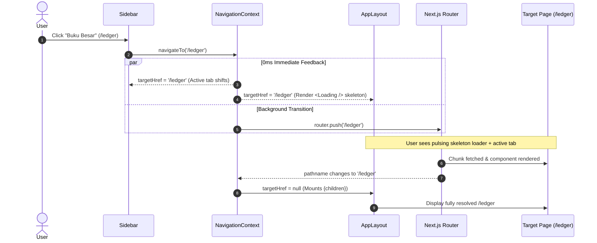

# Instant Optimistic Navigation & Workspace Skeleton Transition Design Spec

## 1. Problem Statement & Motivation
In Next.js 15 App Router, client-side route navigation (`next/link` or `router.push`) is executed inside `React.startTransition`. By design, React Concurrent Mode holds the currently mounted page on screen while the target route's JavaScript chunk and RSC payload are fetched and evaluated. Furthermore, because all operational pages in TimberGuard (`/`, `/ledger`, `/sales`, `/suppliers`, `/activity`, `/settings`) are synchronous Client Components (`'use client'`), they do not suspend on initial client render.

Consequently, `app/loading.tsx` (the root Suspense fallback) is bypassed during client navigation. In development mode (`next dev`), on-demand JIT compilation introduces a 500ms–2000ms delay where the UI remains completely frozen on the old page before abruptly snapping to the destination. Users experience this as non-responsive navigation lag.

The objective is to eliminate this perceived latency entirely: clicking any sidebar navigation link must **immediately (0ms)** shift the active indicator in the sidebar, immediately unmount the previous page, and display the skeleton loader in the main content container while the destination route resolves.

---

## 2. Architecture & Design Principles

### 2.1 Single Source of Navigation Truth (SSOT)
Navigation state is managed via a dedicated, lightweight React Context (`NavigationContext.tsx`) mounted inside `AppLayout`.



### 2.2 Core Component Boundaries
1. **`src/context/NavigationContext.tsx`**:
   - Manages `targetHref: string | null` and `isNavigating: boolean`.
   - Exposes `navigateTo(href: string): void`.
   - Listens to `pathname` updates from `next/navigation` to auto-clear `targetHref`.
   - Enforces a 6000ms safety timeout to self-heal in case of network drops or aborted transitions.
   - Zero external dependencies. File size target < 120 LOC.

2. **`src/components/layout/AppLayout.tsx`**:
   - Wraps the shell in `<NavigationProvider>`.
   - In the main workspace container (`<main>`):
     - If `targetHref && targetHref !== pathname`, mounts `<Loading />` (the root skeleton loader).
     - Otherwise, renders `{children}`.
   - Adheres strictly to the `< 250 LOC` rule (currently 29 LOC).

3. **`src/components/layout/Sidebar.tsx`**:
   - Consumes `useNavigation()`.
   - Evaluates active navigation using `effectivePath = targetHref || pathname`.
   - On link click, calls `navigateTo(item.href)`.
   - Preserves `< 250 LOC` constraint (currently 247 LOC).

4. **`app/loading.tsx`**:
   - Reused directly as the instant skeleton component for the workspace.

---

## 3. Data Flow & Interface Contracts

### 3.1 `NavigationContext` Contract
```typescript
export interface NavigationContextValue {
  /** The destination path currently being navigated to, or null if idle */
  targetHref: string | null;
  /** True whenever an optimistic page transition is in flight */
  isNavigating: boolean;
  /** Initiates an optimistic navigation with immediate visual state commit */
  navigateTo: (href: string) => void;
}
```

### 3.2 Resilience & Edge Cases
- **Same-Route Click**: If `item.href === pathname` or `item.href === targetHref`, `navigateTo` returns immediately with no state change.
- **Rapid Multi-Click**: If a user clicks Route A and quickly clicks Route B, `targetHref` updates to Route B and `router.push(Route B)` supersedes the previous call.
- **Browser Back/Forward Buttons**: Because browser history traversal bypasses sidebar clicks, `targetHref` remains `null`. Next.js handles history navigation normally without ghost skeleton locks.
- **Safety Timeout**: If route resolution stalls beyond 6000ms, the timeout resets `targetHref` to `null` to ensure the UI is never permanently trapped in a loading state.

---

## 4. Verification & Testing Strategy
1. **Unit & Hook Tests (`test/navigation-context.test.ts`)**:
   - Verify initial state: `targetHref === null`, `isNavigating === false`.
   - Verify `navigateTo` sets `targetHref` and `isNavigating = true`.
   - Verify same-path click is ignored.
   - Verify matching `pathname` clears `targetHref`.
   - Verify safety timeout auto-recovers to `null`.
2. **Layout & Sidebar Integration Tests (`test/sidebar.test.ts`)**:
   - Verify `AppLayout.tsx` mounts `NavigationProvider` and conditionally renders `<Loading />`.
   - Verify `Sidebar.tsx` derives active status from `targetHref || pathname`.
   - Verify all coordinator files conform to `< 250 LOC`.
3. **Build & Regression Verification**:
   - Run `npm run build:check` (Next.js production build: 0 errors).
   - Run `npm test` (all existing 472 tests + new tests pass).
