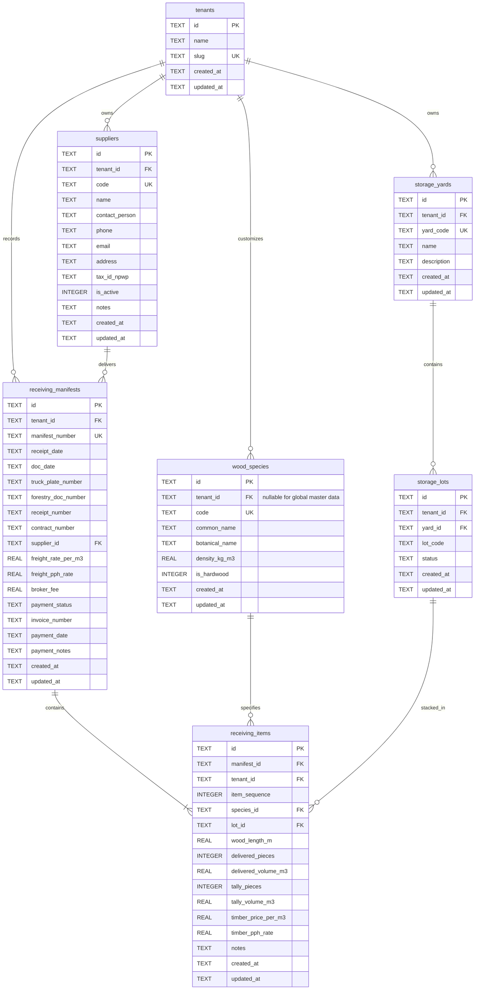

# Relational Database Architecture & Normalization — System Design Spec

**Date:** 2026-10-18  
**Status:** Ready for Review  
**Classification:** Core System Architecture & Data Layer  
**Target:** Node.js 26.8.1 (Native ESM & TypeScript), Native SQLite (`node:sqlite`), REST API Layer, Backward-Compatible Client Adapters  

---

## 1. Problem Statement & Motivation

The wood receiving ledger currently relies on a single unnormalized flat JSON file (`data/wood_records.json`) managed by an in-process Promise-mutex (`ServerRecordStore`), complemented by client-side browser `localStorage` and memory caching.

While effective for early rapid prototyping, this data architecture exhibits six structural defects that constrain factory scalability, multi-tenancy, and operational integrity:

1. **1NF / 2NF Violation (Lack of Header-Detail Split)**:  
   In timber logistics, a single physical truck delivery carries multiple log lengths, species, or kavling stacks. The current flat `WoodReceivingRecord` models delivery transport attributes (truck plate, forestry permit, supplier, freight charges) and timber tally line items (species, length, pieces, m³, kavling, wood price) in a single row. This forces operators to either duplicate freight/truck documents across multiple rows or artificially constrain trucks to a single wood species.
2. **Absence of Foreign Key Referential Integrity**:  
   Attributes such as `supplierName`, `woodSpecies`, and `storageYard` are stored as freeform strings. Typographical errors ("Jati" vs "Teak / Jati (柚木)") or supplier name variations lead to fragmented analytics, broken aggregations, and orphaned records.
3. **Redundant Storing of Derived Financial Values**:  
   Calculated metrics (`timberGrossTotal`, `timberPphAmount`, `timberNetPayable`, `freightGrossTotal`, `freightPphAmount`, `freightNetPayable`, `grandNetPayable`, `volumeDiscrepancyM3`, `pieceDiscrepancy`) are persisted directly into the storage file. Any discrepancy between client and server rounding rules creates data corruption and ledger inconsistency.
4. **Missing Multi-Tenancy Scoping**:  
   Records lack a `tenant_id` partition key. All users and organizations read and write from the same flat file, violating enterprise data boundary invariants defined in `AGENTS.md`.
5. **Dead & Drifted Type Interfaces**:  
   `src/types/index.ts` contains early prototype interfaces (`WoodItem`, `InventoryBatch`, `InventoryTransaction`) that are decoupled from the real-world timber receiving ledger workflow.
6. **Concurrency Ceiling & Risk of Write Contention**:  
   The flat JSON file requires reading and re-serializing the entire database on every mutation under an in-process queue lock. It lacks indexing, transactional rollback, query execution planning, and crashes during write could risk file corruption.

---

## 2. Technical Stack & Engine Selection

In alignment with codebase invariants (**Zero External Dependencies**, **Standard Library First**):

- **Database Engine**: Native Node.js `node:sqlite` (`DatabaseSync` introduced in Node.js 22.5+ and fully stable in Node.js 26.8.1).
  - **No external npm dependencies**: No `better-sqlite3`, `sqlite3`, or heavy native node-gyp compilation required.
  - **Zero latency**: In-process synchronous/asynchronous C-bindings directly in the Node.js runtime.
  - **ACID Transactions**: Full transactional safety with atomic `BEGIN TRANSACTION`, `COMMIT`, and `ROLLBACK`.
  - **Concurrency Configuration**:
    - `PRAGMA journal_mode = WAL;` (Write-Ahead Logging enables non-blocking concurrent readers while a writer commits).
    - `PRAGMA foreign_keys = ON;` (Strict referential constraint enforcement).
    - `PRAGMA busy_timeout = 5000;` (Graceful concurrency wait up to 5 seconds under write contention).
    - `PRAGMA synchronous = NORMAL;` (Optimal durability and write throughput in WAL mode).
- **Database Location**:
  - Production/Development: `data/wood_inventory.db` (configurable via `process.env.WOOD_DB_PATH`).
  - Unit & Contract Tests: `:memory:` (Zero filesystem footprint, sub-millisecond setup and teardown).

---

## 3. Normalized Relational Data Model (3NF)



---

## 4. DDL Specification & Views

### 4.1 Master & Operational Tables

```sql
-- Enforce foreign keys and WAL mode
PRAGMA foreign_keys = ON;
PRAGMA journal_mode = WAL;

-- 1. Tenants (Multi-Tenancy Workspace Partitioning)
CREATE TABLE IF NOT EXISTS tenants (
    id TEXT PRIMARY KEY,
    name TEXT NOT NULL,
    slug TEXT NOT NULL UNIQUE,
    created_at TEXT NOT NULL DEFAULT (datetime('now')),
    updated_at TEXT NOT NULL DEFAULT (datetime('now'))
);

-- 2. Wood Species (Global Master Data / Tenant Custom)
CREATE TABLE IF NOT EXISTS wood_species (
    id TEXT PRIMARY KEY,
    tenant_id TEXT REFERENCES tenants(id) ON DELETE CASCADE,
    code TEXT NOT NULL UNIQUE,
    common_name TEXT NOT NULL,
    botanical_name TEXT,
    density_kg_m3 REAL NOT NULL DEFAULT 650.0,
    is_hardwood INTEGER NOT NULL DEFAULT 1 CHECK (is_hardwood IN (0, 1)),
    created_at TEXT NOT NULL DEFAULT (datetime('now')),
    updated_at TEXT NOT NULL DEFAULT (datetime('now'))
);
CREATE INDEX IF NOT EXISTS idx_species_name ON wood_species(common_name);

-- 3. Storage Yards & Lots (Kavling)
CREATE TABLE IF NOT EXISTS storage_yards (
    id TEXT PRIMARY KEY,
    tenant_id TEXT NOT NULL REFERENCES tenants(id) ON DELETE CASCADE,
    yard_code TEXT NOT NULL,
    name TEXT NOT NULL,
    description TEXT,
    created_at TEXT NOT NULL DEFAULT (datetime('now')),
    updated_at TEXT NOT NULL DEFAULT (datetime('now')),
    UNIQUE(tenant_id, yard_code)
);

CREATE TABLE IF NOT EXISTS storage_lots (
    id TEXT PRIMARY KEY,
    tenant_id TEXT NOT NULL REFERENCES tenants(id) ON DELETE CASCADE,
    yard_id TEXT NOT NULL REFERENCES storage_yards(id) ON DELETE CASCADE,
    lot_code TEXT NOT NULL,
    status TEXT NOT NULL DEFAULT 'ACTIVE' CHECK (status IN ('ACTIVE', 'FULL', 'MAINTENANCE')),
    created_at TEXT NOT NULL DEFAULT (datetime('now')),
    updated_at TEXT NOT NULL DEFAULT (datetime('now')),
    UNIQUE(tenant_id, yard_id, lot_code)
);
CREATE INDEX IF NOT EXISTS idx_storage_lots_code ON storage_lots(tenant_id, lot_code);

-- 4. Suppliers (SSOT Supplier Master)
CREATE TABLE IF NOT EXISTS suppliers (
    id TEXT PRIMARY KEY,
    tenant_id TEXT NOT NULL REFERENCES tenants(id) ON DELETE CASCADE,
    code TEXT NOT NULL,
    name TEXT NOT NULL,
    contact_person TEXT,
    phone TEXT,
    email TEXT,
    address TEXT,
    tax_id_npwp TEXT,
    is_active INTEGER NOT NULL DEFAULT 1 CHECK (is_active IN (0, 1)),
    notes TEXT,
    created_at TEXT NOT NULL DEFAULT (datetime('now')),
    updated_at TEXT NOT NULL DEFAULT (datetime('now')),
    UNIQUE(tenant_id, code)
);
CREATE INDEX IF NOT EXISTS idx_suppliers_name ON suppliers(tenant_id, name);

-- 5. Receiving Manifests (Header: Truck, Documents, Logistics, Payment)
CREATE TABLE IF NOT EXISTS receiving_manifests (
    id TEXT PRIMARY KEY,
    tenant_id TEXT NOT NULL REFERENCES tenants(id) ON DELETE CASCADE,
    manifest_number TEXT NOT NULL,
    receipt_date TEXT NOT NULL,
    doc_date TEXT,
    truck_plate_number TEXT NOT NULL,
    forestry_doc_number TEXT NOT NULL,
    receipt_number TEXT NOT NULL,
    contract_number TEXT NOT NULL,
    supplier_id TEXT NOT NULL REFERENCES suppliers(id) ON DELETE RESTRICT,
    freight_rate_per_m3 REAL NOT NULL DEFAULT 0.0 CHECK (freight_rate_per_m3 >= 0),
    freight_pph_rate REAL NOT NULL DEFAULT 2.0 CHECK (freight_pph_rate >= 0),
    broker_fee REAL NOT NULL DEFAULT 0.0 CHECK (broker_fee >= 0),
    payment_status TEXT NOT NULL DEFAULT 'UNPAID' CHECK (payment_status IN ('UNPAID', 'PARTIAL', 'PAID')),
    invoice_number TEXT,
    payment_date TEXT,
    payment_notes TEXT,
    created_at TEXT NOT NULL DEFAULT (datetime('now')),
    updated_at TEXT NOT NULL DEFAULT (datetime('now')),
    UNIQUE(tenant_id, manifest_number)
);
CREATE INDEX IF NOT EXISTS idx_manifests_date ON receiving_manifests(tenant_id, receipt_date);
CREATE INDEX IF NOT EXISTS idx_manifests_truck ON receiving_manifests(tenant_id, truck_plate_number);
CREATE INDEX IF NOT EXISTS idx_manifests_invoice ON receiving_manifests(tenant_id, invoice_number);
CREATE INDEX IF NOT EXISTS idx_manifests_supplier ON receiving_manifests(supplier_id);

-- 6. Receiving Items (Detail / Line Items: Dimensions, Quantities, Pricing)
CREATE TABLE IF NOT EXISTS receiving_items (
    id TEXT PRIMARY KEY,
    manifest_id TEXT NOT NULL REFERENCES receiving_manifests(id) ON DELETE CASCADE,
    tenant_id TEXT NOT NULL REFERENCES tenants(id) ON DELETE CASCADE,
    item_sequence INTEGER NOT NULL DEFAULT 1,
    species_id TEXT NOT NULL REFERENCES wood_species(id) ON DELETE RESTRICT,
    lot_id TEXT REFERENCES storage_lots(id) ON DELETE SET NULL,
    wood_length_m REAL NOT NULL CHECK (wood_length_m > 0),
    delivered_pieces INTEGER NOT NULL CHECK (delivered_pieces >= 0),
    delivered_volume_m3 REAL NOT NULL CHECK (delivered_volume_m3 >= 0),
    tally_pieces INTEGER NOT NULL CHECK (tally_pieces >= 0),
    tally_volume_m3 REAL NOT NULL CHECK (tally_volume_m3 >= 0),
    timber_price_per_m3 REAL NOT NULL DEFAULT 0.0 CHECK (timber_price_per_m3 >= 0),
    timber_pph_rate REAL NOT NULL DEFAULT 0.5 CHECK (timber_pph_rate >= 0),
    notes TEXT,
    created_at TEXT NOT NULL DEFAULT (datetime('now')),
    updated_at TEXT NOT NULL DEFAULT (datetime('now'))
);
CREATE INDEX IF NOT EXISTS idx_items_manifest ON receiving_items(manifest_id);
CREATE INDEX IF NOT EXISTS idx_items_species ON receiving_items(species_id);
CREATE INDEX IF NOT EXISTS idx_items_lot ON receiving_items(lot_id);
```

### 4.2 Computed Views (Eliminating Stored Derived Values)

```sql
-- 1. Line Item Computed Financials View
CREATE VIEW IF NOT EXISTS v_receiving_item_financials AS
SELECT
    i.id AS item_id,
    i.manifest_id,
    i.tenant_id,
    i.item_sequence,
    i.species_id,
    s.common_name AS species_name,
    i.lot_id,
    l.lot_code AS kavling_number,
    y.name AS storage_yard,
    i.wood_length_m,
    i.delivered_pieces,
    i.delivered_volume_m3,
    i.tally_pieces,
    i.tally_volume_m3,
    (i.tally_pieces - i.delivered_pieces) AS piece_discrepancy,
    ROUND(i.tally_volume_m3 - i.delivered_volume_m3, 4) AS volume_discrepancy_m3,
    i.timber_price_per_m3,
    ROUND(i.tally_volume_m3 * i.timber_price_per_m3, 2) AS timber_gross_total,
    i.timber_pph_rate,
    ROUND((i.tally_volume_m3 * i.timber_price_per_m3) * (i.timber_pph_rate / 100.0), 2) AS timber_pph_amount,
    ROUND(
        (i.tally_volume_m3 * i.timber_price_per_m3) - 
        ((i.tally_volume_m3 * i.timber_price_per_m3) * (i.timber_pph_rate / 100.0)),
        2
    ) AS timber_net_payable
FROM receiving_items i
JOIN wood_species s ON i.species_id = s.id
LEFT JOIN storage_lots l ON i.lot_id = l.id
LEFT JOIN storage_yards y ON l.yard_id = y.id;

-- 2. Manifest Header Aggregate Summary View
CREATE VIEW IF NOT EXISTS v_receiving_manifest_summaries AS
SELECT
    m.id AS manifest_id,
    m.tenant_id,
    m.manifest_number,
    m.receipt_date,
    m.doc_date,
    m.truck_plate_number,
    m.forestry_doc_number,
    m.receipt_number,
    m.contract_number,
    m.supplier_id,
    sup.name AS supplier_name,
    COUNT(i.id) AS total_line_items,
    COALESCE(SUM(i.delivered_pieces), 0) AS total_delivered_pieces,
    COALESCE(ROUND(SUM(i.delivered_volume_m3), 4), 0.0) AS total_delivered_volume_m3,
    COALESCE(SUM(i.tally_pieces), 0) AS total_tally_pieces,
    COALESCE(ROUND(SUM(i.tally_volume_m3), 4), 0.0) AS total_tally_volume_m3,
    COALESCE(SUM(f.timber_gross_total), 0.0) AS total_timber_gross,
    COALESCE(SUM(f.timber_pph_amount), 0.0) AS total_timber_pph,
    COALESCE(SUM(f.timber_net_payable), 0.0) AS total_timber_net,
    m.freight_rate_per_m3,
    ROUND(COALESCE(SUM(i.tally_volume_m3), 0.0) * m.freight_rate_per_m3, 2) AS freight_gross_total,
    m.freight_pph_rate,
    ROUND((COALESCE(SUM(i.tally_volume_m3), 0.0) * m.freight_rate_per_m3) * (m.freight_pph_rate / 100.0), 2) AS freight_pph_amount,
    ROUND(
        (COALESCE(SUM(i.tally_volume_m3), 0.0) * m.freight_rate_per_m3) -
        ((COALESCE(SUM(i.tally_volume_m3), 0.0) * m.freight_rate_per_m3) * (m.freight_pph_rate / 100.0)),
        2
    ) AS freight_net_payable,
    m.broker_fee,
    ROUND(
        COALESCE(SUM(f.timber_net_payable), 0.0) +
        ((COALESCE(SUM(i.tally_volume_m3), 0.0) * m.freight_rate_per_m3) -
        ((COALESCE(SUM(i.tally_volume_m3), 0.0) * m.freight_rate_per_m3) * (m.freight_pph_rate / 100.0))) +
        m.broker_fee,
        2
    ) AS grand_net_payable,
    m.payment_status,
    m.invoice_number,
    m.payment_date,
    m.payment_notes,
    m.created_at,
    m.updated_at
FROM receiving_manifests m
JOIN suppliers sup ON m.supplier_id = sup.id
LEFT JOIN receiving_items i ON m.id = i.manifest_id
LEFT JOIN v_receiving_item_financials f ON i.id = f.item_id
GROUP BY m.id;

-- 3. Backward-Compatible Flat View (Mirrors WoodReceivingRecord SSOT)
CREATE VIEW IF NOT EXISTS v_buku_besar_flat AS
SELECT
    -- If multi-item, generate synthetic deterministic ID: manifestId or manifestId_itemId
    CASE 
        WHEN (SELECT COUNT(*) FROM receiving_items ri WHERE ri.manifest_id = m.id) = 1 
        THEN m.id 
        ELSE m.id || '_' || i.id 
    END AS id,
    m.id AS manifest_id,
    i.id AS item_id,
    m.tenant_id,
    m.receipt_date AS receiptDate,
    m.doc_date AS docDate,
    m.truck_plate_number AS truckPlateNumber,
    m.forestry_doc_number AS forestryDocNumber,
    m.receipt_number AS receiptNumber,
    m.contract_number AS contractNumber,
    sup.name AS supplierName,
    s.common_name AS woodSpecies,
    i.wood_length_m AS woodLengthM,
    COALESCE(l.lot_code, '') AS kavlingNumber,
    COALESCE(y.name, '') AS storageYard,
    i.delivered_pieces AS deliveredPieces,
    i.delivered_volume_m3 AS deliveredVolumeM3,
    i.tally_pieces AS tallyPieces,
    i.tally_volume_m3 AS tallyVolumeM3,
    i.timber_price_per_m3 AS timberPricePerM3,
    f.timber_gross_total AS timberGrossTotal,
    i.timber_pph_rate AS timberPphRate,
    f.timber_pph_amount AS timberPphAmount,
    f.timber_net_payable AS timberNetPayable,
    m.freight_rate_per_m3 AS freightRatePerM3,
    ROUND(i.tally_volume_m3 * m.freight_rate_per_m3, 2) AS freightGrossTotal,
    ROUND((i.tally_volume_m3 * m.freight_rate_per_m3) * (m.freight_pph_rate / 100.0), 2) AS freightPphAmount,
    ROUND(
        (i.tally_volume_m3 * m.freight_rate_per_m3) -
        ((i.tally_volume_m3 * m.freight_rate_per_m3) * (m.freight_pph_rate / 100.0)),
        2
    ) AS freightNetPayable,
    -- Broker fee allocated or assigned
    m.broker_fee AS brokerFee,
    ROUND(
        f.timber_net_payable +
        ((i.tally_volume_m3 * m.freight_rate_per_m3) -
        ((i.tally_volume_m3 * m.freight_rate_per_m3) * (m.freight_pph_rate / 100.0))) +
        m.broker_fee,
        2
    ) AS grandNetPayable,
    m.payment_status AS paymentStatus,
    m.invoice_number AS invoiceNumber,
    m.payment_date AS paymentDate,
    m.payment_notes AS paymentNotes,
    m.created_at AS createdAt,
    m.updated_at AS updatedAt
FROM receiving_manifests m
JOIN suppliers sup ON m.supplier_id = sup.id
JOIN receiving_items i ON m.id = i.manifest_id
JOIN wood_species s ON i.species_id = s.id
JOIN v_receiving_item_financials f ON i.id = f.item_id
LEFT JOIN storage_lots l ON i.lot_id = l.id
LEFT JOIN storage_yards y ON l.yard_id = y.id;
```

---

## 5. Backward Compatibility & Migration Strategy

To adhere to the Strangler pattern and prevent UI disruptions:

1. **Dual-Read Compatibility via `SqliteRecordStore`**:
   - `SqliteRecordStore` replaces `ServerRecordStore` while maintaining the exact same asynchronous interface:
     - `getAll(): Promise<WoodReceivingRecord[]>`
     - `getById(id: string): Promise<WoodReceivingRecord | null>`
     - `save(record: WoodReceivingRecord): Promise<WoodReceivingRecord>`
     - `delete(id: string): Promise<boolean>`
     - `reset(): Promise<WoodReceivingRecord[]>`
   - Querying `getAll()` executes against `v_buku_besar_flat`. The existing 37 test suites and React frontend consume the exact same payload shape without modifying any UI components.
2. **Automated Zero-Data-Loss Migration**:
   - An automated migration script (`src/persistence/sqlite/migrate-json.ts`) is executed on startup if the SQLite database is uninitialized:
     - Reads existing `data/wood_records.json` (or `seed-data.ts` fallback).
     - Inserts the default tenant `default-tenant`.
     - Extracts unique suppliers, upserts into `suppliers`.
     - Extracts unique wood species, upserts into `wood_species`.
     - Extracts unique storage yards and lots, upserts into `storage_yards` and `storage_lots`.
     - Inserts `receiving_manifests` and associated `receiving_items`.
3. **Dead Code & Type Modernization**:
   - Clean up dead interfaces in `src/types/index.ts` (`WoodItem`, `InventoryBatch`, `InventoryTransaction`).
   - Add new formal relational types: `ReceivingManifest`, `ReceivingItem`, `ManifestWithItems`, `StorageYard`, `StorageLot`.
   - Preserve `WoodReceivingRecord` as the canonical flattened projection for ledger and Excel view compatibility.

---

## 6. Verification & Test Architecture

- **In-Memory Testing**: `new DatabaseSync(':memory:')` executed via `node:test`.
  - Zero disk I/O, independent test database instance per test file, running in milliseconds.
- **Round-Trip Parity Assertions**:
  - Verify that saving a `WoodReceivingRecord` through `SqliteRecordStore` updates `receiving_manifests` and `receiving_items`, and querying `getAll()` returns matching mathematical outputs (gross, tax, net, discrepancy).
- **Concurrency & WAL Mode Verification**:
  - Spawn concurrent asynchronous save operations and verify zero `SQLITE_BUSY` crashes and 0 dropped records.

