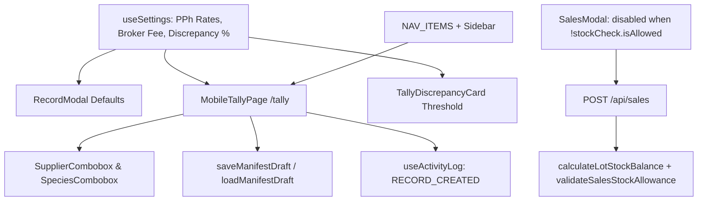

# Domain & Operational Workflow Fixes Specification (P1)

- **Date:** 2026-10-20
- **Status:** Approved
- **Subsystem:** Outbound Sales Stock Guard, System Settings Propagation, Mobile Tally Workflow & Ledger Toolbar Filtering
- **Authors:** Senior Software Engineer (Pair Programmer)

---

## 1. Problem Statement & Root Cause Analysis

Four P1 domain and operational workflow defects currently allow invalid inventory states, ignore user-configured financial/tolerance parameters, and leave field operators with an incomplete mobile tally experience:

### 1.1 Negative Stock Outflow Is Not Blocked (`SalesModal.tsx`, `app/api/sales/route.ts`)
- **Client Gap**: `src/components/sales/SalesModal.tsx:L56-L59,L176-L181` computes `stockCheck = validateSalesStockAllowance(balance, formData.volumeM3, formData.pieces)` and renders a red warning box when `!stockCheck.isAllowed`, but neither disables the submit button nor blocks `handleSubmit`.
- **Server Gap**: `app/api/sales/route.ts:L78-L92` validates `pieces > 0` and `volumeM3 > 0`, but never queries current inbound records (`serverRecordStore.getAll()`) and existing outbound sales (`salesStore.getAll()`) to verify that the target `(storageYard, kavlingNumber)` lot actually has sufficient remaining volume and pieces.

### 1.2 System Settings Are Disconnected from Forms & Discrepancy Calculators (`useSettings.ts`)
- `/settings` (`src/hooks/useSettings.ts`) allows managers to configure:
  - `defaultTimberPphRate` (default `0.5%`)
  - `defaultFreightPphRate` (default `2.0%`)
  - `defaultBrokerFee` (default `Rp 250.000`)
  - `acceptableDiscrepancyThresholdPct` (default `2.0%`)
  - `yardName` / `yardCode`
- **Disconnected Consumers**:
  - `src/components/ledger/RecordModal.tsx:L31,L40` hardcodes `brokerFee: 0` and `timberPphRate: 0.5`.
  - `app/tally/page.tsx:L76-L77` hardcodes `timberPricePerM3: 1500000` and `timberPphRate: 0.015` (which is also a unit mismatch: `0.015` vs `0.5` percentage format).
  - `src/components/tally/TallyDiscrepancyCard.tsx:L24-L25` hardcodes `±0.05 m³` absolute volume difference instead of evaluating `acceptableDiscrepancyThresholdPct` from settings.

### 1.3 Mobile Tally Page (`/tally`) Is Undiscoverable & Incomplete (`app/tally/page.tsx`, `nav-config.ts`)
- **Undiscoverable Route**: `src/components/layout/nav-config.ts` and `src/components/layout/Sidebar.tsx` omit `/tally` (`id: 'tally'`), forcing yard operators to type the URL manually.
- **Unstandardized Inputs**: `app/tally/page.tsx:L128,L134` uses plain `<input type="text">` for Supplier and Wood Species instead of `<SupplierCombobox />` and `<SpeciesCombobox />`.
- **No Draft Resilience or Audit Trail**: Closing or refreshing `/tally` mid-inspection loses all entered truck/tally data (`record-draft.ts` is not wired), and saving a manifest on `/tally` never logs `RECORD_CREATED` via `useActivityLog`.

### 1.4 Missing `'PARTIAL'` Payment Filter Pill in Ledger Toolbar (`Toolbar.tsx`)
- `src/components/ledger/Toolbar.tsx:L146-L183` renders quick-filter pills only for `Semua Status`, `Belum Lunas (UNPAID)`, and `Lunas (PAID)`.
- Manifests with `paymentStatus === 'PARTIAL'` (`Sebagian / DP`) cannot be filtered in `/ledger`, breaking parity with `/sales` (`app/sales/page.tsx:L128-L131`).

---

## 2. Architectural Objectives & Design Decisions

1. **End-to-End Lot Stock Balance Enforcement**:
   - **Client (`SalesModal.tsx`)**: Guard `handleSubmit` so submission is blocked when `!stockCheck.isAllowed`, and bind `disabled={isSubmitting || !stockCheck.isAllowed}` on the submit button with disabled styling (`opacity-50 cursor-not-allowed`).
   - **Server (`POST /api/sales`)**: Compute `calculateLotStockBalance(inboundRecords, existingSalesExcludingCurrentId, payload.storageYard, payload.kavlingNumber)` and run `validateSalesStockAllowance(balance, payload.volumeM3, payload.pieces)`. If `!stockCheck.isAllowed`, return `HTTP 400` with `{ success: false, error: stockCheck.warning }`.
2. **Settings-Driven Defaults & Discrepancy Tolerance**:
   - Pass `settings` from `useSettings()` (or optional `defaultSettings?: Partial<AppSettings>` prop with fallback to `DEFAULT_SETTINGS`) into `RecordModal`, `MobileTallyPage`, and `TallyDiscrepancyCard`.
   - New receiving records initialize `brokerFee: settings.defaultBrokerFee` and `timberPphRate: settings.defaultTimberPphRate`.
   - `TallyDiscrepancyCard` accepts `acceptableThresholdPct?: number` (default `2.0%`) and classifies a discrepancy as `surplus` or `shortage` when `deliveredVolumeM3 > 0` and `(Math.abs(vDiff) / deliveredVolumeM3) * 100 > acceptableThresholdPct` (falling back to `0.05 m³` when `deliveredVolumeM3 === 0`).
3. **First-Class Mobile Tally (`/tally`) Integration**:
   - Register `{ id: 'tally', labelId: 'Tally Lapangan', labelZh: '现场检尺', href: '/tally' }` in `NAV_ITEMS` (`src/components/layout/nav-config.ts`) and map `tally: ClipboardCheck` in `Sidebar.tsx`.
   - Replace free-text supplier and species inputs in `app/tally/page.tsx` with `<SupplierCombobox />` and `<SpeciesCombobox />`, wire `useActivityLog` (`RECORD_CREATED`) and `useSettings()`, and persist in-progress tally drafts via `saveManifestDraft` / `loadManifestDraft` while keeping `app/tally/page.tsx` under the 200-line test invariant.
4. **Complete Payment Status Filter Pills in `Toolbar.tsx`**:
   - Add the `Sebagian / DP (部分付款)` pill (`paymentStatus === 'PARTIAL'`) between `Belum Lunas` and `Lunas` in `src/components/ledger/Toolbar.tsx`.

---

## 3. Component & API Data Flow

---

## 4. Verification & Non-Regression Invariants

1. **Strict Line Count Budgets (Enforced by Existing Tests)**:
   - `src/components/sales/SalesModal.tsx` MUST remain `<= 220` lines (`test/sales-components.test.ts:L26`).
   - `app/tally/page.tsx` MUST remain `<= 200` lines (`test/tally-page.test.ts:L12`).
   - `src/components/ledger/Toolbar.tsx` MUST remain `<= 250` lines (`test/toolbar-filters.test.ts:L131`).
2. **Existing Seed Balance Compatibility in `test/api-sales.test.ts`**:
   - In seeded storage (`SEED_WOOD_RECORDS` + `SEED_WOOD_SALES`), lot `TPK-Timur / KAV-01` has `85` inbound pieces (`14.65 m³`) minus `45` outbound pieces (`7.75 m³`) = **`40` pieces and `6.90 m³` remaining**.
   - `test/api-sales.test.ts` must test a valid sale within remaining stock (e.g., `pieces: 10, volumeM3: 3.5`) expecting `200 OK`, and an overdraw sale (e.g., `pieces: 99, volumeM3: 50.0`) expecting `400 Bad Request`.
