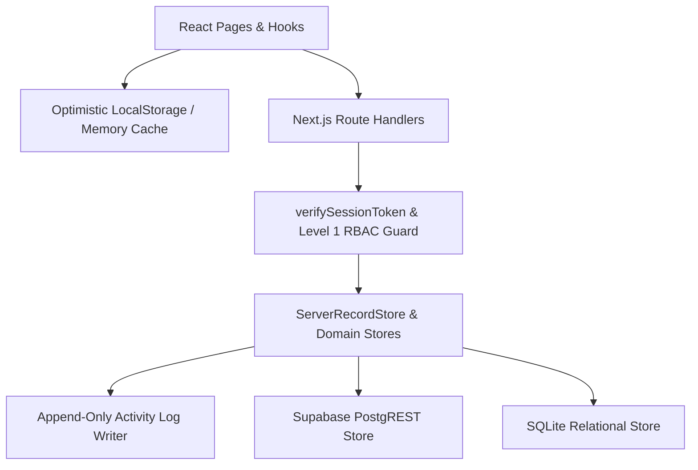

# Persistence Split-Brain & Data Integrity Architecture Specification

- **Date:** 2026-10-20
- **Status:** Approved
- **Subsystem:** Server Persistence Bridge, Master Data Sync, Immutable Audit Ledger & Paginated Query Pipeline
- **Authors:** Senior Software Engineer (Pair Programmer)

---

## 1. Problem Statement & Root Cause Analysis

While inbound receiving records (`/api/records`), outbound sales (`/api/sales`), and storage locations (`/api/storage-locations`) persist to SQLite and Supabase, four critical persistence and data-integrity defects remain across the application:

### 1.1 Split-Brain Master Data & System Settings (`localStorage`-Only Silos)
- **Suppliers (`src/hooks/useSuppliers.ts`, `src/persistence/supplier-repository.ts`)**: Reads and writes exclusively to `window.localStorage` (`wood_suppliers_v1`), despite `suppliers` tables existing in both SQLite (`src/persistence/sqlite/migrations.ts`) and Supabase (`supabase/migrations/20261019000000_init_wood_inventory.sql`).
- **Wood Species (`src/components/settings/SpeciesSettings.tsx`)**: Renders a static constant (`TIMBER_SPECIES_CATALOGUE`) with no server API binding to the `wood_species` table.
- **System Settings (`src/hooks/useSettings.ts`)**: Tax rates (`defaultTimberPphRate`, `defaultFreightPphRate`), broker fees (`defaultBrokerFee`), and discrepancy thresholds (`acceptableDiscrepancyThresholdPct`) are stored exclusively in `window.localStorage` (`wood_app_settings_v1`). A manager updating tax/tolerance thresholds on one workstation does not propagate those rules to yard operators or other devices.

### 1.2 Mutable Client-Side Audit Log (`useActivityLog.ts`, `app/activity/page.tsx`)
- Activity logs live solely in browser `localStorage` (`wood_activity_log_v1`).
- `app/activity/page.tsx` exposes **"Hapus Semua Log" (`clearLogs`)** and **"Reset Log Awal" (`resetLogs`)** buttons, allowing any Level 1 user to erase the operational audit trail.
- Mutations in `/sales` (`saveSale`, `deleteSale`) and `/settings` (`StorageSettings`) bypass activity logging completely because logging is triggered manually inside individual React page handlers rather than enforced at the API persistence boundary.

### 1.3 Client-Only `resetDemo()` Desynchronization (`useWoodRecords.ts`)
- `useWoodRecords.ts:L217-L224` resets `allRecords` and `localStorage` (`wood_receiving_records_next_v1`) to `SEED_WOOD_RECORDS` without calling the server.
- Although `serverRecordStore.reset()` is already implemented in `src/persistence/server-record-store.ts:L237`, no API endpoint invokes it. On the next page refresh or mount, `GET /api/records` overwrites the reset demo state with stale server database rows.

### 1.4 Unbounded Full-Table Fetch on Client Mount (`useWoodRecords.ts`)
- `GET /api/records` and `serverRecordStore.getPaginated(params)` already implement parameterized server-side pagination, filtering, and sorting (`page`, `pageSize`, `searchQuery`, `species`, `kavling`, `yard`, `startDate`, `endDate`, `paymentStatus`, `sortBy`, `sortOrder`).
- However, `useWoodRecords.ts:L94` always calls `fetch('/api/records')` with no query string, pulling the entire table into browser memory on every mount and filtering in-memory.

---

## 2. Architectural Objectives & Invariants

1. **Unified Dual-Tier Persistence (Server SSOT + Optimistic Local Cache)**:
   All master and operational entities (`suppliers`, `wood_species`, `app_settings`, `activity_logs`, `receiving_manifests`, `sales_records`) MUST persist to the active server store (Supabase when configured, SQLite fallback otherwise) while keeping `localStorage` strictly as a resilient optimistic cache.
2. **Append-Only Server-Enforced Audit Trail**:
   `activity_logs` MUST be an immutable, append-only server table. Every authenticated state-mutating request (`POST`, `DELETE`) across `/api/records`, `/api/sales`, `/api/suppliers`, `/api/storage-locations`, and `/api/settings` automatically appends an `ActivityLogEntry` with the authenticated `AuthUser` identity. Client-side log deletion (`DELETE /api/activity` or `clearLogs`) is prohibited.
3. **Deterministic Full-Stack Demo Reset**:
   Triggering `resetDemo()` dispatches `POST /api/records` with `{ action: 'reset' }` (authenticated Level 1 only), invoking `serverRecordStore.reset()`, recording a `DEMO_RESET` audit entry, and returning the canonical seeded records to synchronize client and server state atomically.
4. **Server-Driven Paginated Query Pipeline**:
   `useWoodRecords` constructs query parameters from `RecordQueryParams` (`page`, `pageSize`, `searchQuery`, `species`, `startDate`, `endDate`, `paymentStatus`, `sortBy`, `sortOrder`) and consumes `{ data, pagination }` from `GET /api/records`, exposing `pagination: PaginationMeta` to the ledger view while maintaining offline fallback filtering when disconnected.

---

## 3. Data Schema & API Contracts

### 3.1 SQLite & Supabase Schema Additions (`app_settings` & `activity_logs`)

```sql
-- 9. Tenant System Settings Table
CREATE TABLE IF NOT EXISTS app_settings (
  tenant_id TEXT PRIMARY KEY REFERENCES tenants(id) ON DELETE CASCADE,
  default_timber_pph_rate NUMERIC NOT NULL DEFAULT 0.5 CHECK (default_timber_pph_rate >= 0),
  default_freight_pph_rate NUMERIC NOT NULL DEFAULT 2.0 CHECK (default_freight_pph_rate >= 0),
  default_broker_fee NUMERIC NOT NULL DEFAULT 250000 CHECK (default_broker_fee >= 0),
  acceptable_discrepancy_threshold_pct NUMERIC NOT NULL DEFAULT 2.0 CHECK (acceptable_discrepancy_threshold_pct >= 0),
  yard_name TEXT NOT NULL DEFAULT 'TPK-01 Utama (Central Yard)',
  yard_code TEXT NOT NULL DEFAULT 'TPK-01',
  updated_at TEXT NOT NULL DEFAULT (datetime('now'))
);

-- 10. Immutable Activity Audit Logs Table (Append-Only)
CREATE TABLE IF NOT EXISTS activity_logs (
  id TEXT PRIMARY KEY,
  tenant_id TEXT NOT NULL DEFAULT 'default-tenant',
  action TEXT NOT NULL,
  entity_id TEXT,
  entity_summary TEXT NOT NULL,
  operator_name TEXT NOT NULL,
  operator_role TEXT NOT NULL,
  metadata_json TEXT,
  timestamp TEXT NOT NULL DEFAULT (datetime('now'))
);
CREATE INDEX IF NOT EXISTS idx_activity_logs_timestamp ON activity_logs(tenant_id, timestamp DESC);
CREATE INDEX IF NOT EXISTS idx_activity_logs_action ON activity_logs(tenant_id, action);
```

### 3.2 REST API Endpoints Contract

| Endpoint | Methods | Auth Requirement | Responsibility |
| :--- | :--- | :--- | :--- |
| `/api/suppliers` | `GET`, `POST`, `DELETE` | `GET`: Any authenticated user<br>`POST`/`DELETE`: `roleLevel === 1` | CRUD over `suppliers` table. `DELETE` enforces `ON DELETE RESTRICT` if supplier is referenced by manifests, or soft-deactivates if requested. |
| `/api/species` | `GET`, `POST` | `GET`: Any authenticated user<br>`POST`: `roleLevel === 1` | Retrieves and upserts `wood_species` master catalog rows. |
| `/api/settings` | `GET`, `POST` | `GET`: Any authenticated user<br>`POST`: `roleLevel === 1` | Retrieves and upserts tenant `AppSettings` (`app_settings`). |
| `/api/activity` | `GET`, `POST` | `GET`: Any authenticated user<br>`POST`: `roleLevel === 1` | Append-only audit log retrieval (`?action=&limit=100`) and creation. No `DELETE` method is exposed. |
| `/api/records` | `GET`, `POST`, `DELETE` | `GET`: Any authenticated user<br>`POST`/`DELETE`: `roleLevel === 1` | Extended `POST` to support `{ action: 'reset' }` calling `serverRecordStore.reset()` and recording an immutable `DEMO_RESET` audit event. |

---

## 4. End-to-End Architecture Flow



---

## 5. Verification & Non-Regression Criteria

1. **Zero Duplicate Types**: All new interfaces or query parameters must reside in `src/types/index.ts`.
2. **File Size Invariant (<250 Lines)**: Keep SQLite query helpers (`src/persistence/sqlite/master-data-queries.ts`, `src/persistence/sqlite/activity-queries.ts`) and route handlers modular and under 250 lines.
3. **Test Suite Verification**: Every task must include a targeted `node:test` suite (`test/api-suppliers.test.ts`, `test/api-settings.test.ts`, `test/api-activity.test.ts`, `test/api-records-reset.test.ts`, `test/use-wood-records-pagination.test.ts`) and pass `node --test` with 0 failures.
